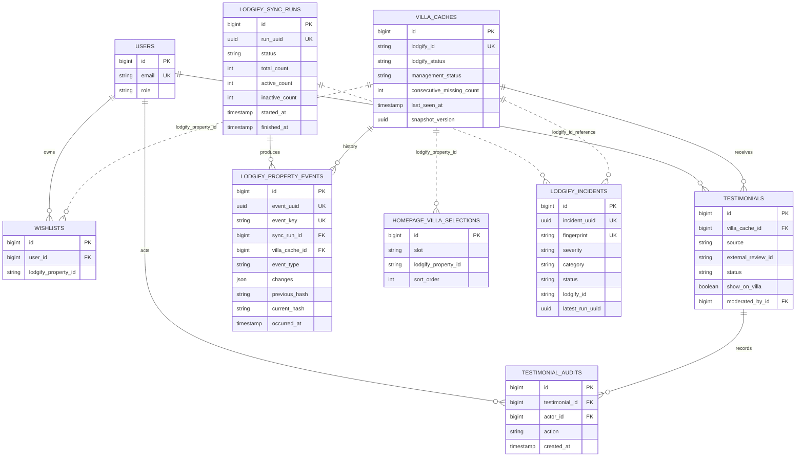

# PHP 8.4 backend readiness audit

Date: 2026-09-21
Scope: read-only backend/runtime audit after PHP 8.4 installation
Decision state: review required before remediation or production rollout

## Executive conclusion

PHP 8.4.25 is installed and the Summerhouses backend runs correctly when that binary is invoked explicitly. The application code, migrations, Laravel boot process, Lodgify inspection, and complete PHPUnit suite are compatible with PHP 8.4.

The current local workflow intentionally selects PHP 8.4 per process instead of replacing the machine-wide default. The command `C:\laragon\bin\php\php-8.4.25\php.exe artisan serve` therefore runs Laravel with PHP 8.4 on HTTP port 8000 even though `where.exe php` still resolves the bare `php` command to PHP 8.1.10. This is valid for manual development, but Composer, Artisan, scheduler, queue workers, and deployment scripts must use the explicit PHP 8.4 executable as well. The PHP 8.4 `zip`, `pdo_sqlite`, and `sqlite3` DLLs exist but are commented out in its `php.ini`.

Production status remains **NO-GO** until the runtime and operational gates below are closed.

## Evidence collected

| Check | Result | Meaning |
| --- | --- | --- |
| Explicit PHP binary | PHP 8.4.25 | Supported by the current backend dependencies. |
| Default terminal PHP | PHP 8.1.10 | Still incompatible with the installed Composer packages. |
| Laravel boot with explicit PHP 8.4 | Laravel 13.32.0 booted | The upgraded framework is operational. |
| Composer platform requirements | PHP passed, `ext-zip` failed | ZIP must be enabled for the real runtime. |
| Composer security audit | No known advisories | Clean at audit time, not a permanent guarantee. |
| Database migrations | All migrations ran through `2026_09_18_000001_hash_otp_codes` | No pending local migration. |
| PHPUnit | 113 tests, 393 assertions passed | Passed using PHP 8.4 with ZIP and SQLite extensions explicitly enabled for the command. |
| Routes | 73 application routes loaded | Auth, CMS, reviews, wishlist, Filament and Lodgify Health routes booted. |
| Failed queue jobs | None recorded | This does not prove a worker is currently supervised. |
| Scheduled definitions | Lodgify sync and health every 5 minutes, daily pruning | Definitions exist, but execution is stale. |
| Lodgify dry-run | 43 properties, 38 active | API read succeeded and wrote no application data. |
| Current database cache | 48 total, 39 publicly eligible | The database is one active-status update and five retained historical records ahead of the current API result. |
| Last persisted sync | 2026-09-15 06:11 UTC | Scheduler/worker execution has been stale for about six days. |
| Open incidents | Three informational homepage fallback incidents | They reference property 751982 and removed property 796460; review after a controlled sync. |

## Findings and priority

### P0 - Explicit runtime selection is not yet applied to background commands

`C:\laragon\bin\php\php-8.4.25\php.exe artisan serve` correctly starts a PHP 8.4 Laravel development server. Port 8000 is only the HTTP listening port; it does not select the PHP version. PATH still resolves a bare `php` command to `C:\laragon\bin\php\php-8.1.10-Win32-vs16-x64\php.exe`. Composer's Windows launcher also calls bare `php`, so it uses PHP 8.1 unless Composer itself is launched through the explicit PHP 8.4 executable.

Why this matters: the website, command prompt, scheduled task, deployment command, and queue supervisor can each use a different PHP executable. A successful browser request alone does not prove background processing is correct.

Required remediation after approval:

1. Keep the current manual server command if changing global PATH is undesirable.
2. Add project-local commands that invoke PHP 8.4 explicitly for Artisan, Composer, scheduler, queue workers and tests.
3. Verify the actual scheduler and worker command lines contain the PHP 8.4 executable path.
4. Treat `where php` as the default CLI diagnostic, not as evidence of the runtime used by an explicitly launched server.
5. Do not remove PHP 8.1 because unrelated local projects may still depend on it.

### P0 - Scheduled Lodgify reconciliation is stale

The schedule contains the correct five-minute jobs, but the latest persisted successful synchronization is from 15 September. The current Lodgify inspection reports 43 total and 38 active, while the local cache reports 48 total and 39 publicly eligible.

Why this matters: an outdated active record can remain visible and incident status cannot self-heal if `schedule:run` or `schedule:work` is not actually executing. Defining a schedule in code is not the same as supervising it.

Required remediation after approval:

1. Fix the CLI runtime first.
2. Run one read-only inspection and save its evidence.
3. Run one controlled full sync while observing the shared lock, sync run, property events and incidents.
4. Run a second sync only if required by the two-pass missing-property policy.
5. Start and supervise the production scheduler, then prove two consecutive five-minute executions.

No villa record should be manually deleted. Retained missing and removed records preserve reviews, selections and audit history.

### P1 - Required PHP extension is disabled

`php_zip.dll` exists, but `extension=zip` is commented out. Composer reports that `openspout/openspout` requires ZIP. SQLite extensions are also present but disabled; they are needed for the current isolated test suite, not necessarily the production database connection.

Required remediation after approval: enable ZIP in the PHP 8.4 configuration used by both web and CLI. Enable SQLite for development/CI where PHPUnit uses the in-memory SQLite database. Restart the relevant processes and rerun platform checks.

### P1 - Production configuration is intentionally unverified

Local preflight passed PHP, encryption key, token lifetime, mailer selection, timeouts, persistent cache selection, queue timing, Lodgify credentials, CORS and most required extensions. It correctly failed local-only settings: production environment, debug off, HTTPS URL, explicit production hosts, secure cookies, and ZIP.

These values must not be changed blindly in the development `.env`. They must be verified on staging and the real production host.

### P1 - Queue and mail are configured but not proven operational

There are no failed jobs, but that can also mean no long-running production worker is active. The configured real mail transport has not been validated with inbox delivery during this audit. SMTP/API credentials, timeout behavior, retry behavior and queue supervision remain deployment gates.

### P2 - Current data drift requires observation, not deletion

The local cache contains:

- 39 active and managed records.
- 4 inactive and managed records: Villa Charli, The Warehouse Loft, Berawa Factory II Canggu, and Casaluna Umalas.
- 1 inactive and removed record: Villa Semanggi.
- 3 missing and managed historical records.
- 1 missing and removed record: Bawa House.

This matches the intended distinction between temporary Lodgify availability and portfolio ownership. The one-record active-count difference must be resolved by the controlled reconciliation, not by an ad hoc database edit.

## Proposed execution order after review

1. Align PHP 8.4 for web, CLI, Composer, scheduler and queue processes.
2. Enable required extensions and rerun `composer check-platform-reqs`.
3. Rerun all backend tests without command-line extension overrides.
4. Execute and observe one controlled Lodgify sync.
5. Verify incidents and Homepage Manager references after reconciliation.
6. Prove scheduler and worker supervision across restart.
7. Validate real mail delivery and failure handling in staging.
8. Run the full production preflight on the target host.
9. Complete backup restore, proxy/TLS, admin access and database privilege checks from the production runbook.

## Operational ERD

Solid relationships below are database foreign keys. Dashed relationships are logical references stored as Lodgify IDs or generic reference fields.

## ERD observations

1. `homepage_villa_selections.lodgify_property_id` and `wishlists.lodgify_property_id` are logical references rather than foreign keys. This intentionally permits retained external IDs, but requires application validation and health checks.
2. `lodgify_incidents` uses UUID/Lodgify references without database foreign keys. This prevents operational evidence from disappearing when related records change, but referential validity must be monitored.
3. `lodgify_property_events` is append-only at the Eloquent model layer. Database administrators can still alter it, so database permissions and external backups are required for stronger audit integrity.
4. Reviews are correctly linked to stable `villa_caches.id`, allowing historical villa records to remain while public visibility is controlled independently.

## Review decision requested

Approve or amend this sequence before implementation. The recommended approval is to fix runtime consistency and ZIP first, then restore scheduler/worker operation and perform a controlled reconciliation. No schema redesign is required to resume the blocked work.
